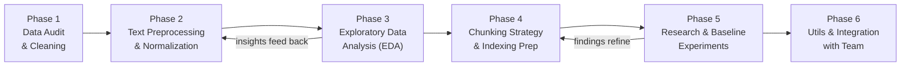

# Master Plan — Data Preprocessing, EDA & Research
## Đoàn Quốc Kiên | UIT Data Science Challenge 2026 – Task 1 (LegalIR)

> **Your Role (Thành viên 1):** Data & Utilities — Thu thập, làm sạch, xử lý dữ liệu, EDA, và xây dựng utils.  
> **Input:** `data/raw/` → **Output:** `data/processed/`

---

## Data Landscape (from analysis)

| Item | Value |
|---|---|
| **Corpus** | 8,532 legal documents (`context_*.json`) |
| **Train set** | 7,000 question-answer pairs (`train.json`) |
| **Public test** | 1,000 questions, answers hidden (`public-official.json`) |
| **Unique docs in train answers** | 3,105 / 8,532 (36.4%) |
| **Answer distribution** | 92.1% single-answer, 6.9% two-answer, 1% three+ |
| **Passage length** | 0 → 5.98M chars; median 23K, mean 41K |
| **Empty passages** | 20 documents with 0 chars |
| **Missing `name` field** | 1,125 / 8,532 (13.2%) |
| **Max 5 doc_ids per question** | Hard constraint (else Recall & Precision = 0) |
| **Primary metric** | Recall (higher = better), Precision as tiebreaker |

---

## Technical Decisions & Feedback Incorporated

- **Q1: Boilerplate removal scope**: Do not strip headers aggressively; instead, normalize headers into concise, structured metadata forms for focused context.
- **Q2: Vietnamese tokenizer**: Use `VnCoreNLP` for high-accuracy word segmentation and syntactic parsing.
- **Q3: Chunking granularity**: Implement adaptive/multi-granularity chunking strategies tailored to document size tiers (e.g. short vs massive 100k+ char docs).
- **Q4: 20 Empty-passage documents**: Check if any appear in `train.json`. Exclude or flag if absent.
- **Q5: Team coordination**: Flexible timeline determined internally by Data & Utilities pipeline readiness.

---

## Phase Overview

---

## Phase 1: Data Audit & Cleaning

**Goal:** Produce a clean, validated, unified dataset with no surprises for downstream consumers.

### 1.1 — Corpus Integrity Check
- [x] Verify all 8,532 context files parse without error
- [x] Identify and catalog the 20 empty-passage documents (0 chars) & verify if present in `train.json`
- [x] Identify the 1,125 documents missing the `name` field
- [x] Check for encoding anomalies
- [x] Check `\r\n` vs `\n` inconsistencies

### 1.2 — Train/Test Data Validation
- [x] Confirm all 3,105 referenced doc IDs in `train.json` exist in corpus
- [x] Confirm no overlap between `train.json` and `public-official.json`
- [x] Profile question ID format consistency

### 1.3 — Unified Corpus Builder
- [x] Merge all 8,532 context files into `data/processed/corpus.jsonl`
- [x] Add derived fields: `passage_length`, `has_name`, `doc_type` (inferred from name/link)
- [x] Handle empty passages (flag them)

### 1.4 — Cleaned Train/Test Builder
- [x] Convert `train.json` into `data/processed/train_clean.jsonl` with fields: `question_id`, `question`, `answer_doc_ids`, `num_answers`
- [x] Produce `data/processed/public_test.jsonl`
- [x] Create `data/processed/train_val_split.json` (80/20 split) for local evaluation
- [x] Generate `docs/data_audit_report.md`

---

## Phase 2: Text Preprocessing & Normalization
**Goal:** Standardize text format and tokenize words to prepare for indexing and embeddings.

- [x] Apply NFC Unicode normalization to questions and corpus passages.
- [x] Normalize whitespaces and line breaks (`\r\n` to `\n`, limit consecutive empty lines).
- [x] Generate fallback passage text from URL slugs for the 20 empty documents.
- [x] Integrate `VnCoreNLP` for highly accurate Vietnamese word segmentation.
- [x] Optimize segmentation pipeline using `ProcessPoolExecutor` with parallel JVMs to eliminate socket bottlenecks.
- [x] Produce preprocessed datasets (`corpus_preprocessed.jsonl`, `train_preprocessed.jsonl`, etc.).
- [x] Generate `docs/preprocessing_report.md`.

---

## Phase 3: Exploratory Data Analysis (EDA)
**Goal:** Understand the corpus, query intents, and relationship between queries and target documents to inform the retrieval strategy.

- [x] Analyze document taxonomy and target rates (e.g., *Luật* is targeted most frequently).
- [x] Compare passage lengths: Discover that target answer docs are ~36% longer (median 33K chars) than distractors.
- [x] Classify question intents (Nội dung quy định, Quy trình, Thẩm quyền, v.v.).
- [x] Deep dive into multi-answer questions (7.9% of queries require synthesis across multiple docs).
- [x] Extract the top 15 "hot" documents that answer the most training questions.
- [x] Generate `docs/eda_report.md` with actionable retrieval architecture recommendations.

---

## Phase 4: Chunking Strategy & Indexing Preparation
**Goal:** Split large legal documents into smaller, semantically cohesive chunks suitable for the embedding model's context window.

- [x] Define chunking configuration (`MAX_SEQ_LENGTH = 512`, `OVERLAP_TOKENS = 50`) in `src/config/chunking_config.py`.
- [x] Implement adaptive structural chunker in `src/ingestion + EDA/chunker.py`.
- [x] Split structurally along `Điều`, `Chương`, `Mục` boundaries to avoid truncating legal clauses.
- [x] Apply sliding window fallback only when a single structural section exceeds the token limit.
- [x] Include metadata (`chunk_id`, `doc_id`, `legal_section`) to support score aggregation.
- [x] Run `run_phase4.py` to output the final `data/processed/chunks_corpus.jsonl` for Vectorstore ingestion.

---

## Phase 5: Research & Baseline Experiments
**Goal:** Implement and evaluate baseline retrieval models before advancing to complex architectures.

- [x] Implement Sparse Retrieval baseline using `BM25` (with `VnCoreNLP` segmented text).
- [ ] Implement Dense Retrieval baseline using Vietnamese legal embedding models.
- [x] Create a local evaluation script (`src/evaluation/eval.py`) to measure Top-K Retrieval accuracy, MRR, and NDCG using `val_preprocessed.jsonl`.
- [x] Compare retrieval performance between sparse, dense, and hybrid approaches.
- [x] Document baseline results and select the best model for Phase 6.

---

## Phase 6: Shared Utils & Integration
**Goal:** Consolidate shared logic and prepare the codebase for seamless integration with other team members.

- [x] Refactor common functions (e.g., logging, file I/O) into `src/utils/`.
- [x] Centralize all configuration variables (paths, hyperparameters) in `src/config/`.
- [x] Update `requirements.txt` with all necessary dependencies (e.g., `py_vncorenlp`, `tqdm`).
- [x] Conduct a final code review and clean up temporary or scratch files.
